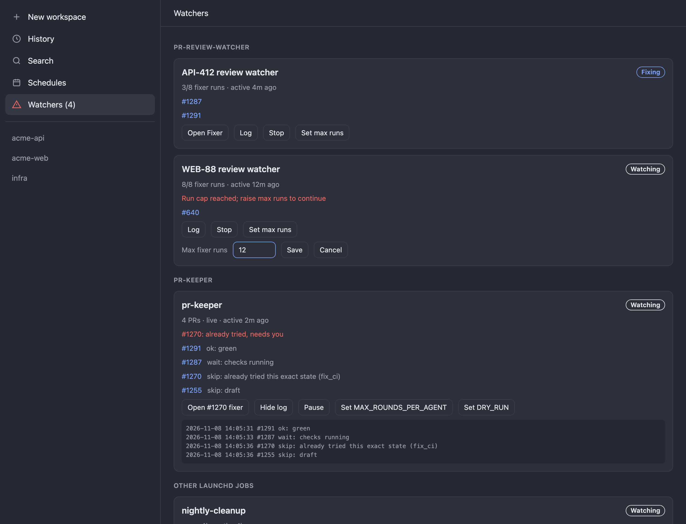
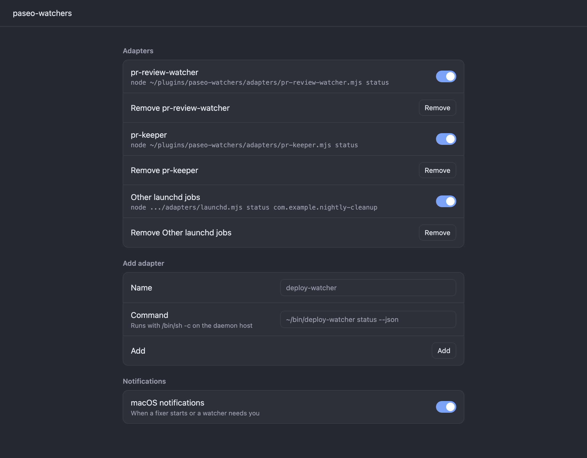

# paseo-watchers

A [Paseo](https://paseo.sh) plugin that puts every background watcher on your machine in one panel: PR review bots, CI keepers, cron-style launchd jobs, anything that runs unattended and starts agents.

New kinds of watcher plug in as **adapters**. An adapter is a command that prints its watchers as JSON and declares the buttons the panel shows. Adding a watcher type needs no change to the plugin.





_The screenshots are mockups with sample data._

## What you get

- A **Watchers** row in the sidebar, with a count of running watchers. Its icon changes when a fixer is working or a watcher needs you.
- A screen grouped by adapter. Each watcher shows its status (Watching, Fixing, Stopped, Error), last activity, PR links with per-PR notes, an attention line when it needs you, and its log tail.
- The actions each adapter declares: start and stop, open the fixer agent in Paseo, and set values such as max runs.
- **Settings → Plugins → paseo-watchers → Adapters**, where you add, enable and remove adapters.
- macOS notifications from the daemon, polled every minute. You get one when a new fixer agent starts, and one when a watcher's attention text changes. The first poll after a restart only records state, and a failed poll keeps the last known state, so old alerts are not replayed.

## Install

```bash
git clone https://github.com/nickmaglowsch/paseo-watchers
paseo plugin install ./paseo-watchers
```

Then add adapters under Settings → Plugins → paseo-watchers. Use an absolute path to `node`, because the daemon's `PATH` may not include version managers such as mise or nvm.

## Bundled adapters

| Adapter | Command | Watches | Actions |
| --- | --- | --- | --- |
| `adapters/pr-review-watcher.mjs` | `node …/pr-review-watcher.mjs status` | Each `~/.local/state/pr-review-watcher/<name>/` watch: its launchd job, fixer runs and log | Start, Stop, Set max runs |
| `adapters/pr-keeper.mjs` | `node …/pr-keeper.mjs status` | The `com.pr-keeper` launchd job, each PR's latest state, and NOTIFY lines | Start, Pause, Set `MAX_ROUNDS_PER_AGENT`, `MAX_AGENT_RUNS_PER_DAY`, `DRY_RUN` |
| `adapters/launchd.mjs` | `node …/launchd.mjs status <label>...` | Any job in `~/Library/LaunchAgents`: loaded, process alive, last exit status, log tail | Start, Stop |

Config edits are atomic and serialized with `lockf`.

## Write an adapter

Any executable works. The command you register must print:

```json
{
  "watchers": [
    {
      "id": "deploy-prod",
      "title": "Prod deploy watcher",
      "status": "running",
      "busy": true,
      "detail": "3 deploys today",
      "lastTick": "2026-11-08T14:05:31Z",
      "attention": "Rollback needs approval",
      "links": [{ "label": "#1287", "url": "https://github.com/acme/api/pull/1287", "note": "ok: green" }],
      "agents": [{ "id": "<paseo agent id>", "label": "Fixer" }],
      "log": ["last few log lines"],
      "actions": [
        { "id": "stop", "label": "Stop", "command": ["/usr/local/bin/deploy-watcher", "stop", "prod"] },
        {
          "id": "max",
          "label": "Set max runs",
          "command": ["/usr/local/bin/deploy-watcher", "set-max", "prod"],
          "input": { "label": "Max runs", "value": "8" }
        }
      ]
    }
  ]
}
```

- `status` is `running`, `stopped` or `error`. Stopped watchers are hidden behind "Show N stopped".
- `attention` is free text meaning "needs you". A new value raises a notification. Keep it stable while nothing changes: leave out timestamps.
- `agents` are Paseo agent IDs. Each new ID raises a "started" notification, and the panel opens it on tap.
- `actions[].command` is an argv array, run without a shell. With `input`, the panel asks for a value and appends it as the last argument. Validate it in your adapter.
- `lastTick` is the last activity you can see. A watcher that polls silently will look older than it is.

The full schema is `adapterOutput` in [`shared/watchers.ts`](shared/watchers.ts).

## Security

Adapter commands run as the daemon user through `/bin/sh -c`. The action commands they declare run as the daemon user too, as argv without a shell. Only register adapters you trust. The app never sends a command: it sends an adapter, watcher and action ID, and the daemon re-runs the adapter to look up the command.

## Development

```bash
npm install
npm run typecheck
npm test
paseo plugin reload paseo-watchers
```
